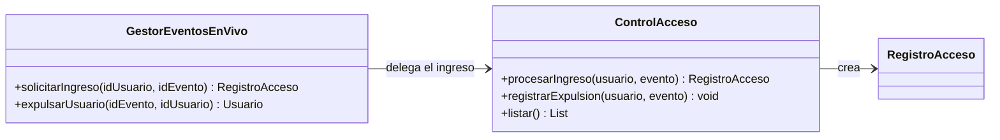
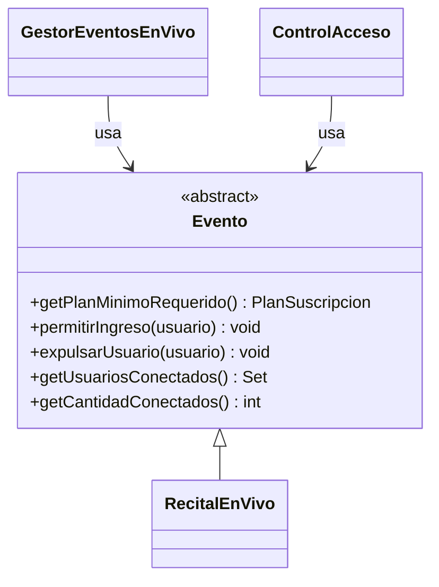
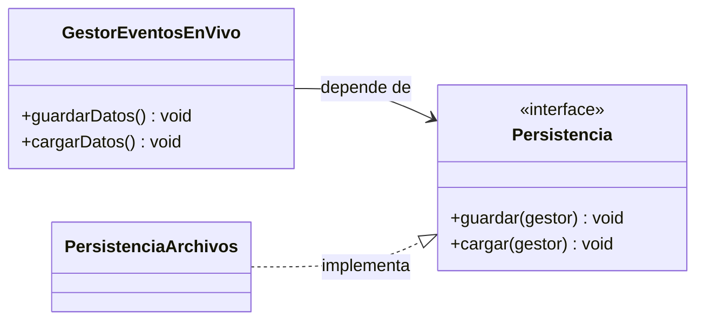

# Iteración 4: principios SOLID

Módulo: UADE Beats, acceso a eventos en vivo

## 1. Resumen

| Principio | Problema detectado | Solución aplicada |
|---|---|---|
| Responsabilidad única | `GestorEventosEnVivo` administraba usuarios, artistas y eventos, y además resolvía los ingresos y guardaba los registros de acceso | Nueva clase `ControlAcceso` con esa única responsabilidad |
| Abierto y cerrado | El gestor y las vistas verificaban con `instanceof` que el evento fuera un `RecitalEnVivo` y lo convertían con un cast | `Evento` declara las operaciones de ingreso, expulsión y consulta de conectados, y los clientes trabajan con `Evento` |
| Sustitución de Liskov | El gestor rechazaba cualquier evento que no fuera `RecitalEnVivo`, por lo que una subclase de `Evento` no podía reemplazar a un recital | Cualquier subclase de `Evento` puede usarse en el gestor y en las vistas sin modificarlos |
| Segregación de interfaces | No había una interfaz con métodos que sus clientes no usaran | La nueva interfaz `Persistencia` tiene solo las dos operaciones que el gestor necesita |
| Inversión de dependencias | El gestor y las vistas dependían de la clase concreta `PersistenciaArchivos` | El gestor depende de la interfaz `Persistencia`, que recibe por constructor |

## 2. Responsabilidad única

Antes, `GestorEventosEnVivo` concentraba dos responsabilidades distintas: administrar las colecciones de usuarios, artistas y eventos, y decidir si un usuario puede ingresar a un evento, dejando constancia de cada intento.

`ControlAcceso` se encarga ahora de resolver cada solicitud de ingreso y de llevar la trazabilidad.

| Clase | Responsabilidad |
|---|---|
| `GestorEventosEnVivo` | Altas, búsquedas, ciclo de vida de los eventos y expulsión. Delega la solicitud de ingreso. |
| `ControlAcceso` | Validar el ingreso, crear el registro de cada intento, guardar los registros y registrar las expulsiones. |

El gestor pasó de 521 a 385 líneas. La solicitud de ingreso en el gestor quedó reducida a buscar al usuario y al evento y delegar la decisión.



## 3. Abierto y cerrado, y sustitución de Liskov

Antes, para solicitar un ingreso o expulsar a un usuario, el gestor comprobaba el tipo concreto del evento:

```java
if (!(evento instanceof RecitalEnVivo)) {
    // rechaza: "Tipo de evento no soportado por este modulo."
}
RecitalEnVivo recital = (RecitalEnVivo) evento;
```

Cada tipo nuevo de evento obligaba a modificar el gestor y las vistas, y ningún evento que no fuera un recital podía usarse. Ahora `Evento` declara las operaciones que sus clientes necesitan y cada subclase las implementa.

| Operación declarada en `Evento` | Uso |
|---|---|
| `getPlanMinimoRequerido()` | Determinar el plan que exige el evento |
| `permitirIngreso(usuario)` | Conectar al usuario o rechazar el ingreso |
| `expulsarUsuario(usuario)` | Desconectar al usuario |
| `getUsuariosConectados()` | Listar los usuarios conectados |
| `getCantidadConectados()` | Mostrar la ocupación del evento |



El gestor, `ControlAcceso` y las vistas dependen solamente de `Evento`. Un tipo nuevo de evento se agrega creando una subclase, sin modificar ninguna de estas clases, y puede reemplazar a un recital en cualquier lugar donde se use un `Evento`.

## 4. Segregación de interfaces

La única interfaz del módulo es `Persistencia`, con dos operaciones que el gestor utiliza ambas. Ninguna clase que la implementa debe definir métodos que no necesita.

## 5. Inversión de dependencias

Antes, las vistas y el gestor invocaban directamente a la clase concreta `PersistenciaArchivos`. Ahora el gestor recibe por constructor una `Persistencia` y las vistas piden guardar o cargar al gestor.



| Elemento | Antes | Después |
|---|---|---|
| Creación del gestor | `new GestorEventosEnVivo()` | `new GestorEventosEnVivo(new PersistenciaArchivos())` |
| Guardado desde las vistas | `PersistenciaArchivos.guardarDatos(gestor)` | `gestor.guardarDatos()` |
| Carga desde las vistas | `PersistenciaArchivos.cargarDatos(gestor)` | `gestor.cargarDatos()` |

La interfaz pertenece al paquete del gestor, que es el módulo de alto nivel. Para almacenar en otro medio alcanza con escribir una nueva clase que implemente `Persistencia` y pasarla al crear el gestor.

## 6. Alcance

`PersistenciaArchivos` conserva una comprobación de tipo al guardar un evento, porque el formato de archivo incluye campos propios del recital. Esa decisión depende del formato de almacenamiento y no del flujo de negocio.

## 7. Ejecución

Desde `TP/Grupo9_POO_EntregaFinal/Codigo/src`:

```
javac -d ../out $(find . -name "*.java")
java -cp ../out Main
java -cp ../out app.AppSwing
```
