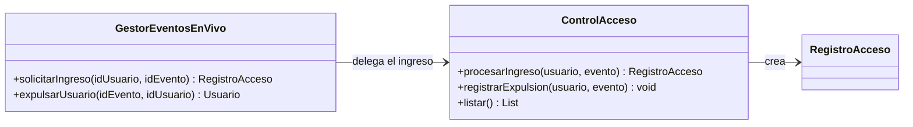
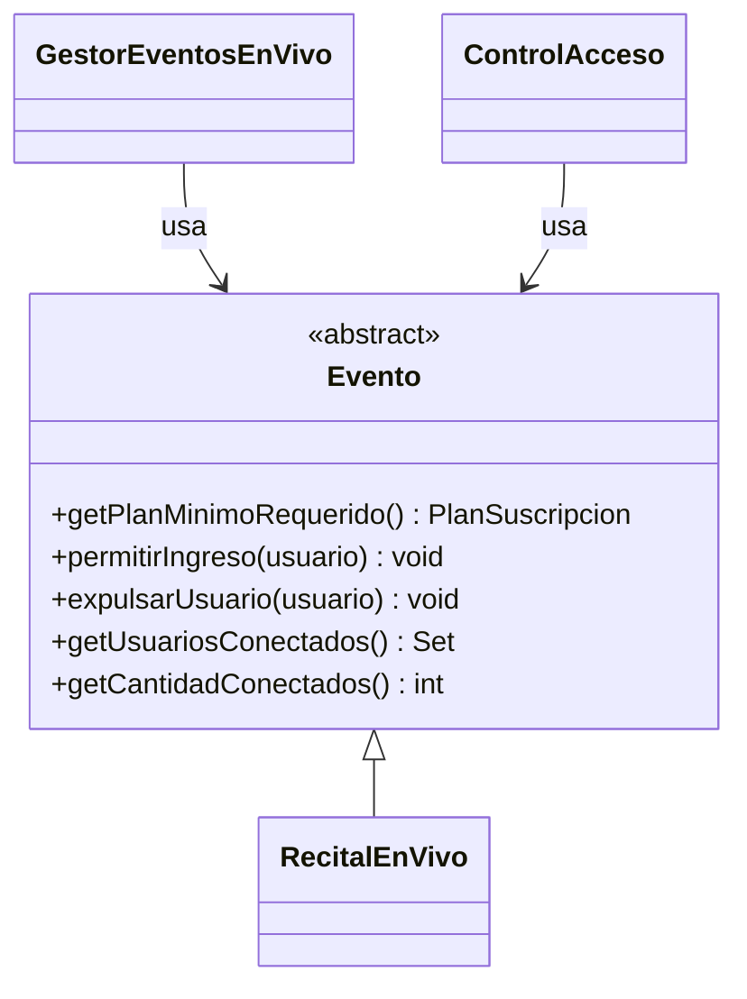
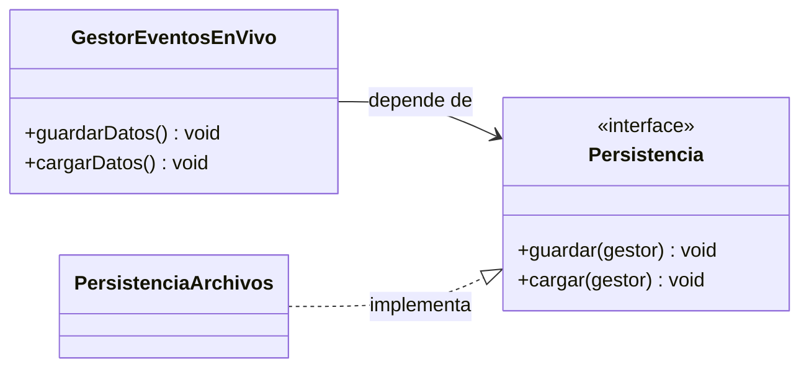
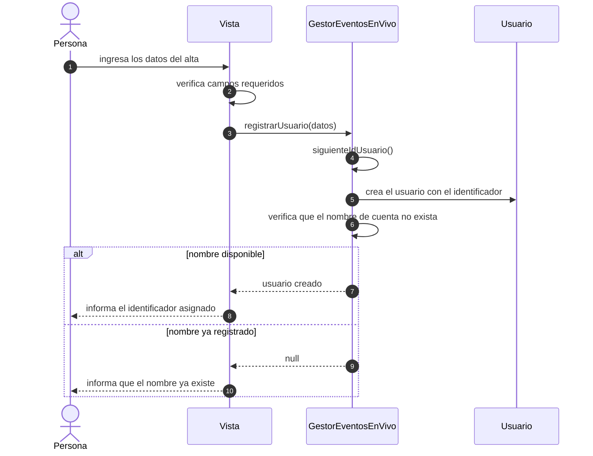
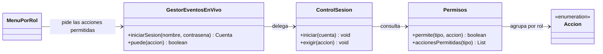
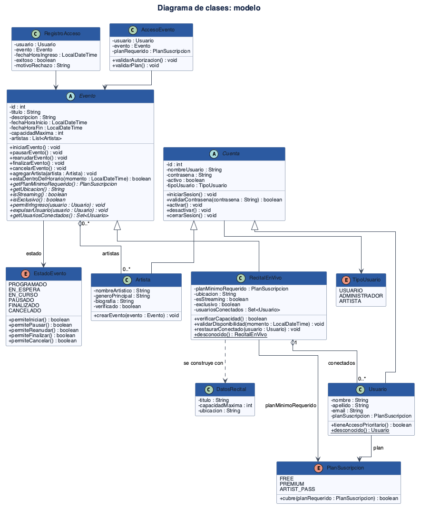
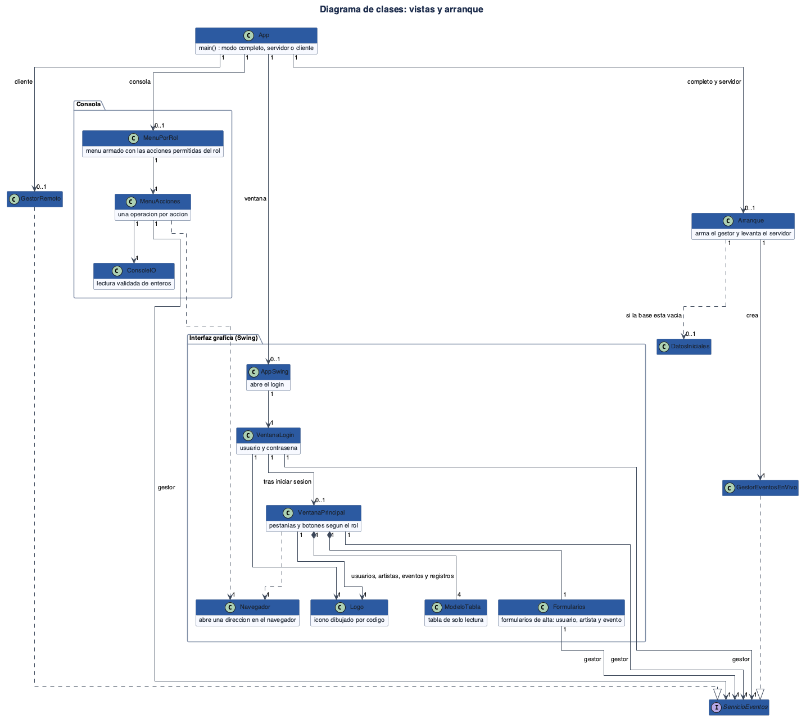

# Iteración 3: principios SOLID


Módulo: UADE Beats, acceso a eventos en vivo

## 1. Resumen

La iteración aplica los cinco principios SOLID. A partir de la sección 7 se documentan los cambios complementarios incluidos en la entrega: la arquitectura Modelo Vista Controlador, el sistema de roles y permisos y la preparación de los avisos a los usuarios.

| Principio | Problema detectado | Solución aplicada |
|---|---|---|
| Responsabilidad única | `GestorEventosEnVivo` administraba usuarios, artistas y eventos, y además resolvía los ingresos y guardaba los registros de acceso | Nueva clase `ControlAcceso` con esa única responsabilidad |
| Abierto y cerrado | El gestor y las vistas verificaban con `instanceof` que el evento fuera un `RecitalEnVivo` y lo convertían con un cast | `Evento` declara las operaciones de ingreso, expulsión y consulta de conectados, y los clientes trabajan con `Evento` |
| Sustitución de Liskov | El gestor rechazaba cualquier evento que no fuera `RecitalEnVivo`, por lo que una subclase de `Evento` no podía reemplazar a un recital | Cualquier subclase de `Evento` puede usarse en el gestor y en las vistas sin modificarlos |
| Segregación de interfaces | No había una interfaz con métodos que sus clientes no usaran | La nueva interfaz `Persistencia` tiene solo las dos operaciones que el gestor necesita |
| Inversión de dependencias | El gestor y las vistas dependían de la clase concreta `PersistenciaArchivos` | El gestor depende de la interfaz `Persistencia`, que recibe por constructor |

## 2. Responsabilidad única

Antes, `GestorEventosEnVivo` concentraba dos responsabilidades distintas: administrar las colecciones de usuarios, artistas y eventos, y decidir si un usuario puede ingresar a un evento, dejando constancia de cada intento.

`ControlAcceso` se encarga ahora de resolver cada solicitud de ingreso y de llevar la trazabilidad.

| Clase | Responsabilidad |
|---|---|
| `GestorEventosEnVivo` | Altas, búsquedas, ciclo de vida de los eventos y expulsión. Delega la solicitud de ingreso. |
| `ControlAcceso` | Validar el ingreso, crear el registro de cada intento, guardar los registros y registrar las expulsiones. |

El gestor pasó de 521 a 385 líneas. La solicitud de ingreso en el gestor quedó reducida a buscar al usuario y al evento y delegar la decisión.



## 3. Abierto y cerrado, y sustitución de Liskov

Antes, para solicitar un ingreso o expulsar a un usuario, el gestor comprobaba el tipo concreto del evento:

```java
if (!(evento instanceof RecitalEnVivo)) {
    // rechaza: "Tipo de evento no soportado por este modulo."
}
RecitalEnVivo recital = (RecitalEnVivo) evento;
```

Cada tipo nuevo de evento obligaba a modificar el gestor y las vistas, y ningún evento que no fuera un recital podía usarse. Ahora `Evento` declara las operaciones que sus clientes necesitan y cada subclase las implementa.

| Operación declarada en `Evento` | Uso |
|---|---|
| `getPlanMinimoRequerido()` | Determinar el plan que exige el evento |
| `permitirIngreso(usuario)` | Conectar al usuario o rechazar el ingreso |
| `expulsarUsuario(usuario)` | Desconectar al usuario |
| `getUsuariosConectados()` | Listar los usuarios conectados |
| `getCantidadConectados()` | Mostrar la ocupación del evento |



El gestor, `ControlAcceso` y las vistas dependen solamente de `Evento`. Un tipo nuevo de evento se agrega creando una subclase, sin modificar ninguna de estas clases, y puede reemplazar a un recital en cualquier lugar donde se use un `Evento`.

## 4. Segregación de interfaces

Las interfaces del módulo son chicas y el gestor usa todas sus operaciones: `Persistencia` (guardar y cargar), `Notificador` (una operación), `Calendario` (nombre y agregar) y `VinculoCalendario` (nombre y vincular). Ninguna clase que las implementa debe definir métodos que no necesita.

## 5. Inversión de dependencias

Antes, las vistas y el gestor invocaban directamente a la clase concreta `PersistenciaArchivos`. Ahora el gestor recibe por constructor una `Persistencia` y las vistas piden guardar o cargar al gestor.



| Elemento | Antes | Después |
|---|---|---|
| Creación del gestor | `new GestorEventosEnVivo()` | `new GestorEventosEnVivo(new PersistenciaArchivos())` |
| Guardado desde las vistas | `PersistenciaArchivos.guardarDatos(gestor)` | `gestor.guardarDatos()` |
| Carga desde las vistas | `PersistenciaArchivos.cargarDatos(gestor)` | `gestor.cargarDatos()` |

La interfaz pertenece al paquete del gestor, que es el módulo de alto nivel. Para almacenar en otro medio alcanza con escribir una nueva clase que implemente `Persistencia` y pasarla al crear el gestor. El gestor recibe de la misma forma un `Notificador` para los avisos a los usuarios (sección 10).

## 6. Alcance

`PersistenciaArchivos` conserva una comprobación de tipo al guardar un evento, porque el formato de archivo incluye campos propios del recital. Esa decisión depende del formato de almacenamiento y no del flujo de negocio.

## 7. Arquitectura Modelo Vista Controlador

Las vistas, la de consola (`MenuAcciones`) y la ventana Swing (`VentanaPrincipal`), construían directamente los objetos del modelo y calculaban por su cuenta el identificador de cada entidad, con dos mecanismos distintos. Ahora la vista reúne los datos y el controlador crea el objeto y asigna el identificador.

| Componente | Clases | Responsabilidad |
|---|---|---|
| Modelo | Paquete `modelo` | Datos y reglas de negocio. No conoce la consola ni la ventana. |
| Vista | `MenuAcciones`, `MenuPorRol` y `VentanaPrincipal` | Reunir los datos, verificar campos requeridos, mostrar resultados y enviar cada acción al controlador. |
| Controlador | `GestorEventosEnVivo` | Recibir los pedidos de la vista, crear los objetos del modelo, asignar identificadores y devolver el resultado. |

| Operación del controlador | Datos que recibe | Resultado |
|---|---|---|
| `registrarUsuario` | Nombre de cuenta, nombre, apellido, email, contraseña y plan | El usuario creado, o `null` si el nombre de cuenta ya existe |
| `registrarArtista` | Nombre de cuenta, contraseña y datos artísticos | El artista creado, o `null` si el nombre de cuenta ya existe |
| `crearEvento` | `DatosRecital` y artista asociado | El recital creado y asociado al artista |

El identificador siguiente se calcula en el controlador como el mayor existente más uno, porque es quien conoce las colecciones. Esto reemplaza los contadores de la consola y los métodos equivalentes de la ventana.



| Capa | Validación |
|---|---|
| Vista | Campos requeridos completos y valores numéricos bien formados |
| Controlador | Unicidad del nombre de cuenta y permisos de la cuenta que inició sesión |
| Modelo | Reglas de negocio: estado y horario del evento, capacidad, plan mínimo y transiciones de estado |

## 8. Roles y permisos

Cada cuenta tiene un rol (`TipoUsuario`): usuario, artista o administrador. Al iniciar el programa se pide el login y, según el rol de la cuenta, se muestra el menú que le corresponde. Las opciones de cada menú no están escritas una por una: se arman con las acciones que la tabla de permisos habilita para ese rol.

| Acción | Usuario | Artista | Administrador |
|---|---|---|---|
| Solicitar ingreso a un evento | Solo a su nombre | No | Sí |
| Ver eventos | Todos | Solo los propios | Todos |
| Ver capacidad de un evento | Sí | Solo los propios | Sí |
| Agregar un evento a Google o Apple Calendar | Sí | Solo los propios | Sí |
| Vincular mi calendario (Google o Apple) | Sí | Sí | Sí |
| Ver sus registros de acceso | Sí | No | No |
| Crear un evento | No | A su nombre | Sí |
| Iniciar, pausar, reanudar, finalizar y cancelar un evento | No | Solo los propios | Cualquiera |
| Ver los usuarios conectados | No | Solo los propios | Sí |
| Registrar usuarios y artistas | No | No | Sí |
| Activar o desactivar usuarios | No | No | Sí |
| Expulsar a un usuario | No | No | Sí |
| Ver todos los registros, guardar y cargar datos | No | No | Sí |
| Abrir la ventana gráfica | Sí | Sí | Sí |



| Pieza | Responsabilidad |
|---|---|
| `Accion` | Enumera las acciones del sistema con la etiqueta que se muestra en el menú. |
| `Permisos` | Única tabla de permisos por rol. Cambiar los permisos de un rol implica modificar solo esta clase. |
| `ControlSesion` | Guarda la cuenta con sesión iniciada y rechaza las acciones no permitidas. |
| `MenuPorRol` | Único menú de consola, armado con las acciones que el gestor informa como permitidas. |

### Autorización en el controlador

El gestor verifica el permiso en cada operación, de modo que una acción no permitida se rechaza aunque se invoque sin pasar por el menú. Además del rol, controla la pertenencia: un usuario solo solicita ingresos a su nombre, y un artista solo crea y gestiona eventos propios. Sin sesión iniciada, toda operación se rechaza con `PermisoDenegadoException`.

### Cuentas

El login funciona igual para los tres roles. Los nombres de cuenta son únicos entre usuarios y artistas, y una cuenta sin contraseña no puede iniciar sesión. El administrador da de alta a los artistas con nombre de cuenta y contraseña. La ventana gráfica se abre para cualquier cuenta y muestra solo las pestañas y los botones que permite su rol: el usuario ve los eventos, solicita ingresos a su nombre y consulta sus registros; el artista ve y gestiona únicamente sus eventos; el administrador accede a todas las pestañas.

| Rol | Cuenta | Contraseña | Plan |
|---|---|---|---|
| Administrador | `admin` | `admin123` | Premium |
| Artista | `bandahorizonte` | `horizonte2024` | |
| Artista | `djprisma` | `prisma2024` | |
| Artista | `lunanocturna` | `luna2024` | |
| Artista | `losdelsur` | `sur2024` | |
| Usuario | `lgabian` | `lgabian2024` | Premium |
| Usuario | `lferraro` | `lferraro2024` | Artist Pass |
| Usuario | `ncaggia` | `ncaggia2024` | Free |
| Usuario | `mrossi` | `mrossi2024` | Premium |
| Usuario | `jperez` | `jperez2024` | Free |
| Usuario | `sdiaz` | `sdiaz2024` | Artist Pass |
| Usuario | `tgomez` | `tgomez2024` | Free, cuenta inactiva |

El administrador puede activar o desactivar usuarios. Una cuenta inactiva no puede iniciar sesión ni ingresar a eventos, y al desactivarla se la desconecta de los eventos en los que estaba. Un administrador no puede desactivar su propia cuenta.

### Inicio del programa y ventana de login

Al iniciar, el programa pregunta con qué interfaz se usa: interfaz gráfica (Swing) o consola. La interfaz gráfica empieza con una ventana de login simple, con usuario y contraseña. Si los datos son correctos se abre la ventana del rol de la cuenta, y el botón de cerrar sesión devuelve a la ventana de login. Si la ventana se abre desde el menú de consola, usa la sesión de ese menú.

Las ventanas usan un logo propio, que reemplaza el ícono por defecto de Java en la ventana y en el Dock. Se dibuja por código en la clase `Logo`, por lo que no hay archivos que empaquetar.

### Uso de la ventana

| Aspecto | Comportamiento |
|---|---|
| Tablas | Los datos se muestran en tablas ordenables por columna. El estado de cada evento se colorea según su valor y un doble clic sobre un evento muestra sus usuarios conectados. |
| Botones | Los botones están agrupados en dos filas, una para el ciclo de vida del evento y otra para la gestión. Cada botón se habilita solo cuando la acción es posible: hace falta un evento seleccionado y que su estado la permita. |
| Mensajes | Los resultados correctos se informan en la barra de estado, en verde, sin ventana emergente. Los errores se muestran también en una ventana para que no pasen desapercibidos. |
| Formularios | Registrar un usuario, registrar un artista y crear un evento se hacen en una sola ventana con todos los campos. Si un dato no es válido se informa el motivo y el formulario vuelve a abrirse con lo ya cargado. |

Las reglas de qué transición permite cada estado están en `EstadoEvento`. Las usan el propio evento, el gestor, el menú de consola y la ventana, de modo que no se repiten en cada interfaz.

## 9. Persistencia y datos de prueba

Los datos se guardan en cuatro archivos de texto de la carpeta `datos`, con un registro por línea y campos separados por `|`.

| Archivo | Contenido de cada línea |
|---|---|
| `usuarios.txt` | Identificador, cuenta, nombre, apellido, email, contraseña, plan, activo y rol |
| `artistas.txt` | Identificador, nombre artístico, género, biografía, verificado, cuenta, contraseña y rol |
| `eventos.txt` | Identificador, título, descripción, inicio, fin, estado, capacidad, plan mínimo, ubicación, streaming, exclusivo, artistas y usuarios conectados |
| `registros_acceso.txt` | Fecha, usuario, evento, resultado y motivo del rechazo |

| Aspecto | Comportamiento |
|---|---|
| Guardado | Después de cada cambio (altas, ingresos, expulsiones, cambios de estado y activación de usuarios) los datos se guardan solos. Las opciones de guardar y cargar manualmente siguen disponibles para el administrador. |
| Textos | Un `|` o un salto de línea dentro de un nombre, una contraseña o una biografía se guarda codificado y se lee tal como fue escrito. |
| Conectados | Los usuarios conectados a cada evento se guardan y se restauran. Un evento finalizado o cancelado desconecta a todos. |
| Archivos viejos | Los formatos anteriores, con menos campos, siguen cargando. |
| Arranque | Si un archivo está dañado se informa y se usan los datos de prueba. Si no hay ningún administrador, se agrega uno para que siempre se pueda iniciar sesión. |
| Registros sin entidad | Los intentos de ingreso de un usuario o un evento inexistente se informan al momento pero no se guardan, porque no refieren a ninguna entidad real. |

Los archivos entregados traen datos de prueba coherentes entre sí: ocho usuarios, cuatro artistas, seis eventos en distintos estados y dieciséis accesos vinculados a los usuarios.

| Evento | Estado | Plan mínimo | Conectados |
|---|---|---|---|
| 100 Rock en Vivo | En curso | Premium | `lgabian`, `mrossi` y `lferraro` (3 de 5) |
| 101 Backstage Prisma Live | En espera | Artist Pass | Ninguno |
| 102 Noche de Folklore | Pausado | Free | `ncaggia` (1 de 20) |
| 103 Luna en Vivo (Acústico) | Programado | Free | Ninguno |
| 104 Festival de Verano 2025 | Finalizado | Free | Ninguno |
| 105 Fiesta Electrónica Cancelada | Cancelado | Premium | Ninguno |

Los accesos incluyen ingresos autorizados, rechazos por plan insuficiente, por usuario ya conectado, por evento no disponible y por cuenta inactiva, y dos expulsiones. Con ellos se pueden probar todos los casos del ingreso a un evento.

## 10. Avisos a los usuarios

El gestor recibe un `Notificador`, una interfaz con una sola operación, y `ControlAcceso` la invoca cuando un usuario es expulsado de un evento o se rechaza su solicitud de ingreso. Solo se avisa a las cuentas de rol usuario.

| Hecho | Aviso |
|---|---|
| El usuario es expulsado de un evento | Expulsado del evento, con el título del evento |
| Se rechaza su solicitud de ingreso | Ingreso rechazado, con el motivo |

Por ahora el programa usa `NotificadorInactivo`, que no envía nada. Para entregar los avisos por otro medio alcanza con escribir otra implementación de `Notificador` y pasarla al crear el gestor en `App` y en `AppSwing`, sin modificar el gestor ni `ControlAcceso`.

## 11. Calendarios

Hay dos formas de llevar los eventos a Google Calendar o Apple Calendar. Ambas están en la pestaña de eventos de la ventana y en el menú de consola, y las puede usar cualquier cuenta.

### Agregar un evento

Con el evento seleccionado, el botón de Google abre el navegador en el enlace oficial «agregar evento» con título, fechas, descripción y lugar ya cargados; el de Apple genera un archivo `.ics` y lo abre con Calendario. Es una copia: no se actualiza si el evento cambia. Un artista solo puede hacerlo con sus propios eventos.

### Vincular mi calendario

La persona se suscribe una sola vez y sus eventos se mantienen al día solos: si un evento cambia de horario aparece el cambio, y si se cancela queda marcado como cancelado.

1. En «Vincular mi calendario» toca Google Calendar o Apple Calendar.
2. Se abre el navegador (Google) o la app Calendario (Apple) con la suscripción ya armada, y confirma allí.
3. Desde ahí el calendario trae los eventos que le corresponden: todos si es administrador, los propios si es artista y aquellos a los que logró ingresar si es usuario.

Cómo funciona por dentro: `ServidorCalendario` (servidor HTTP del JDK, sin dependencias) publica en `/calendario/<código>.ics` el calendario de cada cuenta. El código es un HMAC de la cuenta con una clave que se guarda en `~/.uadebeats/calendario.key`, por lo que no se puede adivinar y no hace falta login; una cuenta desactivada deja de recibir su calendario. Los eventos se arman con `FormatoIcs`, con un `UID` fijo por evento y `STATUS:CANCELLED` cuando corresponde.

| Calendario | Requisito |
|---|---|
| Apple Calendar | Funciona con la dirección local `webcal://localhost:8765/...` si el calendario está en el mismo equipo |
| Google Calendar | Lee la dirección desde sus servidores, por lo que debe ser pública. Se expone el puerto con un túnel (por ejemplo `cloudflared tunnel --url http://localhost:8765`) y se ejecuta con `-Duadebeats.url=https://<dirección del túnel>`. Con la dirección local se informa el motivo y no se abre nada |

El puerto es 8765 y se cambia con `-Duadebeats.puerto`. Google actualiza una suscripción cada varias horas; Apple, en minutos.

El gestor recibe los calendarios como parámetro (`agregarACalendario` y `vincularCalendario`, con las interfaces `Calendario` y `VinculoCalendario`) y verifica los permisos `AGREGAR_A_CALENDARIO` y `VINCULAR_CALENDARIO` antes de delegar. No se guardan contraseñas ni claves de API.

## 12. Diagramas

Los diagramas de clases y de secuencia están actualizados al diseño actual y se generan con PlantUML. Los archivos `.puml` con su código fuente están en `TP/Grupo9_POO_Diagramas_Pdf/fuentes`, y los PDF listos para presentar, con su versión oscura, en `TP/Grupo9_POO_Diagramas_Pdf`.

| Diagrama | Contenido |
|---|---|
| Diagrama de clase | Tres páginas: modelo, controlador con persistencia, avisos y calendarios, y vistas |
| Diagrama de secuencia | Solicitar ingreso a un evento, con control de sesión y permisos, registro del intento y aviso al usuario |

### Modelo



### Controlador, persistencia y avisos


### Vistas



### Solicitar ingreso a un evento


Para regenerarlos, desde `TP/Grupo9_POO_Diagramas_Pdf/fuentes`:

```
java -jar plantuml.jar -charset UTF-8 -tpdf *.puml
```

## 13. Ejecución

Desde `TP/Grupo9_POO_EntregaFinal/Codigo/src`:

```
javac -d ../out $(find . -name "*.java")
java -cp ../out Main
java -cp ../out app.AppSwing
```

`Main` pregunta qué interfaz usar. `AppSwing` abre directamente la ventana gráfica con su login, que se adapta al rol de la cuenta.
