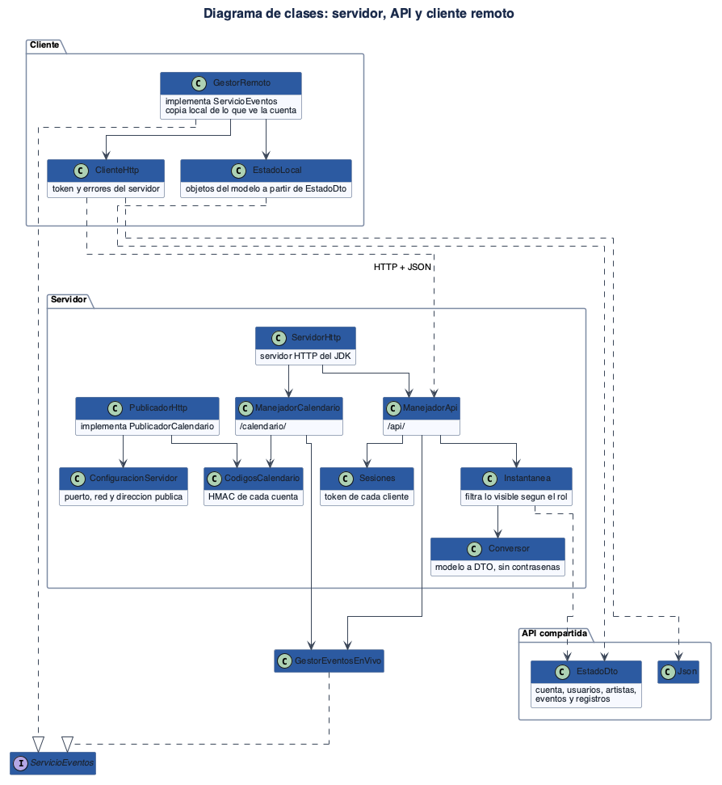
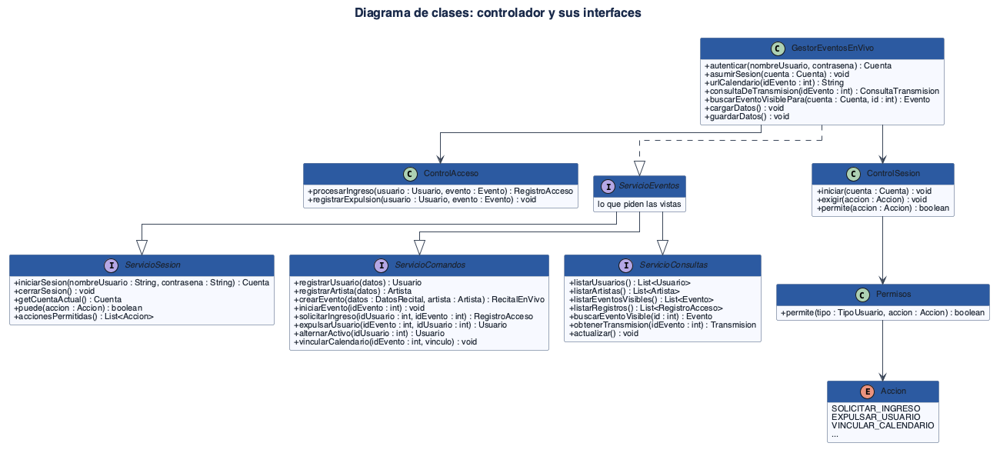
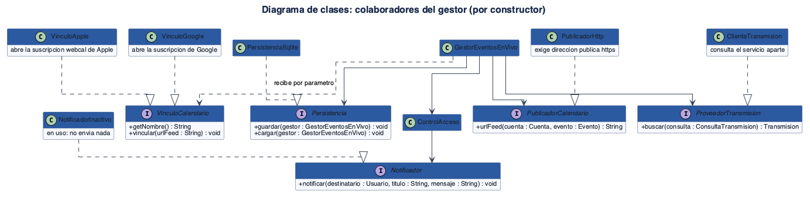
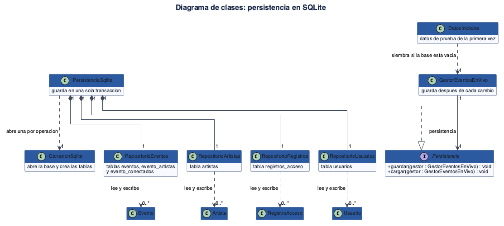
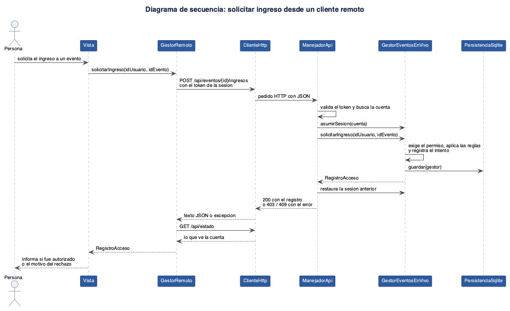
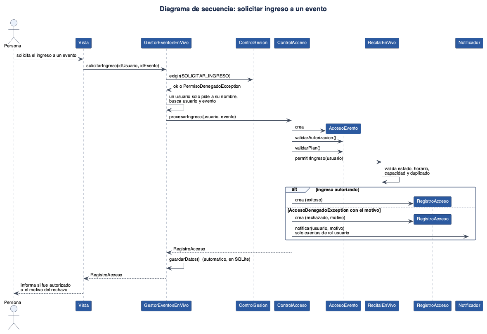

# Iteración 4: base SQLite, API y modo cliente


Módulo: UADE Beats, acceso a eventos en vivo

## 1. Resumen

Esta iteración reemplaza los archivos de texto por una base SQLite, agrega un servidor con una API HTTP y permite abrir el programa en otra PC como solo cliente. Parte de la iteración 3 (principios SOLID, arquitectura MVC y roles y permisos), que no cambia en su diseño.

| Cambio | Qué se hizo |
|---|---|
| Base de datos | Los TXT se reemplazan por una base SQLite. Cada tipo de dato tiene su repositorio y todo se guarda en una transacción. |
| Servidor | El programa expone el gestor por una API HTTP con JSON. Cada pedido lleva el token de una sesión y el servidor filtra lo que ve cada rol. |
| Modo cliente | Otra PC corre solo la interfaz, sin datos propios, y se conecta al servidor. La ventana y la consola son las mismas. |
| Interfaces | Las vistas dependen de `ServicioEventos` y no del gestor concreto, de modo que usan igual un gestor local o uno remoto. |
| Guardado | El gestor guarda después de cada cambio. Se quitan los botones y opciones de guardar y cargar. |
| Contraseñas | Se guardan como hash PBKDF2 con sal por cuenta y nunca en texto plano. |
| Calendarios | Una persona puede suscribir Google Calendar o Apple Calendar a un evento. El servidor publica el calendario de cada evento. |
| Avisos | Se elimina la implementación de ntfy. Queda la interfaz `Notificador` con la implementación inactiva. |

## 2. Modos de ejecución

| Modo | Comando | Qué hace |
|---|---|---|
| Completo | `Main` | Datos propios en SQLite, API para clientes remotos (solo accesible desde el mismo equipo) y ventana o consola local. |
| Servidor | `Main servidor` | Solo datos y API, sin interfaz. Acepta conexiones de la red. Se deja corriendo en una PC. |
| Cliente | `Main cliente http://192.168.0.10:8765` | Solo interfaz. No guarda nada: se conecta al servidor, inicia sesión allí y trabaja con lo que su rol puede ver. |

Los parámetros se pasan como propiedades de Java (`-D`):

| Propiedad | Valor por defecto | Uso |
|---|---|---|
| `uadebeats.db` | `~/.uadebeats/uadebeats.db` | Archivo de la base SQLite. |
| `uadebeats.puerto` | `8765` | Puerto del servidor. |
| `uadebeats.escuchar` | `local` en modo completo, `todas` en modo servidor | `todas` acepta conexiones de la red. |
| `uadebeats.url` | (ninguna) | Dirección pública con https por la que se alcanza el servidor, necesaria para los calendarios. |
| `uadebeats.servidor` | (ninguna) | Dirección del servidor para el modo cliente, si no se la pasa como argumento. |



## 3. Patrones de diseño aplicados

| Patrón | Dónde | Para qué |
|---|---|---|
| Repository | `RepositorioUsuarios`, `RepositorioArtistas`, `RepositorioEventos` y `RepositorioRegistros` | Cada uno traduce entre una tabla y los objetos del modelo. El resto del programa no conoce SQL. |
| Proxy remoto | `GestorRemoto` | Implementa `ServicioEventos` igual que `GestorEventosEnVivo` y reenvía cada pedido al servidor. Las vistas no distinguen cuál usan. |
| DTO | Paquete `api` | Registros que viajan por la red. Ninguno lleva contraseñas, y el servidor los arma ya filtrados por rol. |
| Inversión de dependencias | `Persistencia`, `Notificador`, `PublicadorCalendario` y `VinculoCalendario` | El gestor depende de interfaces que recibe por constructor o por parámetro. `PersistenciaSqlite` reemplaza a la de archivos sin tocar el gestor. |
| Segregación de interfaces | `ServicioSesion`, `ServicioConsultas` y `ServicioComandos` | Tres interfaces chicas que `ServicioEventos` reúne para las vistas. |





## 4. Elecciones y motivos

| Tema | Elección | Alternativa descartada | Motivo |
|---|---|---|---|
| Driver de SQLite | `sqlite-jdbc` como jar en `Codigo/lib` | Descargarlo al compilar | El proyecto compila con `javac` sin Maven. Con el jar en el repositorio funciona sin internet. |
| Acceso del cliente | A través de la API del servidor | Que el cliente abra la base | SQLite es un archivo y no acepta conexiones de red. Además, así los permisos se aplican en un solo lugar. |
| Formato de la API | HTTP con JSON (`gson`) | Sockets con serialización de objetos | Es estándar, legible y no ata cliente y servidor a la misma versión de las clases. Se agregó el jar de `gson`. |
| Servidor HTTP | El del JDK (`com.sun.net.httpserver`) | Un framework web | Ya se usaba para los calendarios y no agrega dependencias. |
| Forma de guardar | Se reescriben las tablas completas en una transacción | Actualizar solo las filas modificadas | Con pocos datos es más simple y la base queda siempre consistente: si algo falla se deshace todo. |
| Quién guarda | El gestor, después de cada operación | Las vistas | Servidor, ventana y consola quedan con el mismo comportamiento y las vistas se simplifican. |
| Persistencia en TXT | Se eliminó junto con los archivos | Dejarla como alternativa | Sin código sin uso. Los datos de prueba pasaron a `DatosIniciales`. |
| Qué ve el cliente | Una copia de solo lectura que se vuelve a pedir tras cada cambio | Repetir las reglas en el cliente | Las reglas y los permisos se aplican solo en el servidor, que es quien las verifica. |
| Hash de contraseñas | PBKDF2 con HMAC-SHA256 del JDK, 120.000 iteraciones y sal aleatoria de 16 bytes por contraseña, en el formato `pbkdf2$iteraciones$sal$hash` | Una librería externa (bcrypt, argon2) | No agrega dependencias. Guardar las iteraciones junto al hash permite subirlas más adelante sin invalidar los hash ya guardados. |
| Sesiones remotas | Token aleatorio por inicio de sesión, en memoria | Enviar usuario y contraseña en cada pedido | La contraseña viaja una sola vez. Al reiniciar el servidor hay que volver a iniciar sesión. |
| Concurrencia | Las operaciones del gestor son `synchronized` y cada pedido remoto abre y devuelve su sesión | Un gestor por sesión | Un solo conjunto de datos compartido. La sesión de quien usa el equipo del servidor no se pisa. |
| Conectados que ve cada rol | Administrador y artista ven nombres; el usuario solo ve cuántos hay | Enviar todo | El servidor no envía datos que el rol no puede ver. |

## 5. Base de datos

Un archivo SQLite con seis tablas. Las claves foráneas están activadas.

| Tabla | Contenido |
|---|---|
| `usuarios` | Usuarios y administrador: cuenta (única, sin distinguir mayúsculas), nombre, apellido, email, hash de la contraseña, plan, activo y rol |
| `artistas` | Cuenta, hash de la contraseña, nombre artístico, género, biografía y verificado |
| `eventos` | Título, descripción, inicio, fin, estado, capacidad, plan mínimo, ubicación, streaming y exclusivo |
| `evento_artistas` | Artistas de cada evento |
| `evento_conectados` | Usuarios conectados a cada evento |
| `registros_acceso` | Usuario, evento, fecha, resultado y motivo del rechazo |

Un intento de ingreso con un usuario o un evento inexistente se informa al momento pero no se guarda, porque no refiere a ninguna fila.



### Datos de prueba

Si la base está vacía, el programa carga ocho usuarios, cuatro artistas, seis eventos en distintos estados y dieciséis accesos coherentes entre sí. Con ellos se pueden probar todos los casos de ingreso a un evento.

| Cuenta | Rol | Contraseña |
|---|---|---|
| `admin` | Administrador | `admin123` |
| `lgabian`, `lferraro`, `ncaggia`, `mrossi`, `jperez`, `sdiaz` | Usuario | `<cuenta>2024` |
| `tgomez` | Usuario inactivo, no puede iniciar sesión | `tgomez2024` |
| `bandahorizonte`, `djprisma`, `lunanocturna`, `losdelsur` | Artista | `horizonte2024`, `prisma2024`, `luna2024` y `sur2024` |

| Evento | Estado | Plan mínimo | Conectados |
|---|---|---|---|
| 100 Rock en Vivo | En curso | Premium | `lgabian`, `mrossi` y `lferraro` (3 de 5) |
| 101 Backstage Prisma Live | En espera | Artist Pass | Ninguno |
| 102 Noche de Folklore | Pausado | Free | `ncaggia` (1 de 20) |
| 103 Luna en Vivo (Acústico) | Programado | Free | Ninguno |
| 104 Festival de Verano 2025 | Finalizado | Free | Ninguno |
| 105 Fiesta Electrónica Cancelada | Cancelado | Premium | Ninguno |

## 6. API

Después de iniciar sesión, cada pedido lleva `Authorization: Bearer <token>`. Los errores devuelven un JSON con `tipo` y `mensaje`, y el cliente los convierte en las mismas excepciones que lanza el gestor local.

| Método y ruta | Acción |
|---|---|
| `POST /api/sesion` | Inicia sesión y devuelve el token |
| `DELETE /api/sesion` | Cierra la sesión |
| `GET /api/estado` | Todo lo que la cuenta puede ver, ya filtrado por rol |
| `POST /api/usuarios` | Registra un usuario |
| `POST /api/usuarios/{id}/alternar-activo` | Activa o desactiva un usuario |
| `POST /api/artistas` | Registra un artista |
| `POST /api/eventos` | Crea un evento a nombre de un artista |
| `POST /api/eventos/{id}/{iniciar, pausar, reanudar, finalizar, cancelar}` | Cambia el estado del evento |
| `POST /api/eventos/{id}/ingresos` | Solicita el ingreso de un usuario |
| `POST /api/eventos/{id}/expulsiones` | Expulsa a un usuario |
| `GET /api/eventos/{id}/calendario` | Dirección del calendario del evento |

| Código | Tipo | Excepción en el cliente |
|---|---|---|
| 409 | `acceso` | `AccesoDenegadoException` (regla del negocio) |
| 403 y 401 | `permiso` y `sesion` | `PermisoDenegadoException` |
| 500 | `persistencia` | `PersistenciaException` |
| 409 | `calendario` | `IOException` |
| 400 | `pedido` | `IllegalArgumentException` |
| Sin conexión | | `ConexionException` |

Qué recibe cada rol en `/api/estado`:

| Rol | Eventos | Usuarios | Registros |
|---|---|---|---|
| Administrador | Todos | Todos | Todos |
| Artista | Solo los suyos | Los conectados a sus eventos | Ninguno |
| Usuario | Todos | Su cuenta y los conectados sin datos personales | Solo los propios |

Las contraseñas nunca viajan al cliente.



## 7. Roles y permisos

Sin cambios respecto de la iteración 3, salvo que se quitan guardar y cargar datos (ahora automáticos) y se agrega el calendario.

| Acción | Usuario | Artista | Administrador |
|---|---|---|---|
| Solicitar ingreso a un evento | Solo a su nombre | No | Sí |
| Ver eventos | Todos | Solo los propios | Todos |
| Ver capacidad de un evento | Sí | Solo los propios | Sí |
| Agregar un evento a mi calendario | Sí | Solo los propios | Sí |
| Ver sus registros de acceso | Sí | No | No |
| Crear un evento | No | A su nombre | Sí |
| Iniciar, pausar, reanudar, finalizar y cancelar un evento | No | Solo los propios | Cualquiera |
| Ver los usuarios conectados | No | Solo los propios | Sí |
| Registrar usuarios y artistas | No | No | Sí |
| Activar o desactivar usuarios | No | No | Sí |
| Expulsar a un usuario | No | No | Sí |
| Ver todos los registros | No | No | Sí |
| Abrir la ventana gráfica | Sí | Sí | Sí |

## 8. Calendarios

Una persona selecciona un evento y toca Google Calendar o Apple Calendar. Se abre el navegador (Google) o la app Calendario (Apple) con la suscripción armada, y confirma allí. Desde entonces ese evento se mantiene al día: si cambia de horario aparece el cambio, y si se cancela queda marcado como cancelado. Puede repetirlo con otros eventos; un artista solo con los suyos.

El servidor publica cada evento en `/calendario/<código>/<id>.ics`. El código es un HMAC de la cuenta con una clave guardada en `~/.uadebeats/calendario.key`, por lo que no se puede adivinar y no hace falta login. Responde 404 si la cuenta está desactivada, el evento no existe o la cuenta no puede verlo. En modo cliente, el pedido pasa por el servidor, que es quien arma la dirección.

Google y Apple se suscriben por https: Calendar convierte `webcal://` en `https://`, y Google además lee la dirección desde sus servidores. Por eso la dirección debe ser pública y con https. Se expone el puerto con un túnel (por ejemplo `cloudflared tunnel --url http://localhost:8765`) y se ejecuta con `-Duadebeats.url=https://<dirección del túnel>`. Con la dirección local se informa el motivo y no se abre nada.

## 9. Diagramas

Se generan con PlantUML. Los fuentes `.puml` están en `TP/Grupo9_POO_Diagramas_Pdf/fuentes` y los PDF listos para presentar, con su versión oscura, en `TP/Grupo9_POO_Diagramas_Pdf`.

| Diagrama | Contenido |
|---|---|
| Diagrama de clase | Seis páginas: modelo, controlador, colaboradores, persistencia, red y vistas |
| Diagrama de secuencia | Solicitar ingreso con el gestor local y desde un cliente remoto |



Para regenerarlos, desde `TP/Grupo9_POO_Diagramas_Pdf/fuentes`:

```
java -jar plantuml.jar -charset UTF-8 -tpdf *.puml
```

## 10. Ejecución

Desde `TP/Grupo9_POO_EntregaFinal/Codigo`:

```
javac -encoding UTF-8 -cp "lib/*" -d out $(find src -name "*.java")
java --enable-native-access=ALL-UNNAMED -cp "out:lib/*" Main
java --enable-native-access=ALL-UNNAMED -cp "out:lib/*" Main servidor
java -cp "out:lib/*" Main cliente http://192.168.0.10:8765
```

Para exponer el servidor con un túnel de Cloudflare en un solo paso (requiere `cloudflared`), desde la misma carpeta:

```
./servidor-publico.sh
```

El script abre el túnel, toma la dirección https que le asignan, arranca el servidor con `-Duadebeats.url` y muestra el comando para conectar un cliente. Con el argumento `completo` arranca además la interfaz local. Ctrl+C cierra el túnel y el servidor.

En Windows el separador del classpath es `;` en lugar de `:`. La opción `--enable-native-access` evita el aviso que muestra Java al cargar el driver de SQLite; el modo cliente no usa SQLite y no la necesita.

Para usar el cliente desde otra PC, el servidor debe aceptar conexiones de la red (modo `servidor`, o el completo con `-Duadebeats.escuchar=todas`) y el puerto estar abierto en el firewall.

## 11. Limitaciones conocidas

| Limitación | Detalle |
|---|---|
| Conexión sin cifrar | La API usa HTTP. Fuera de una red de confianza conviene exponerla por un túnel con https o una VPN, porque el inicio de sesión envía la contraseña. En la base y en la memoria del servidor solo queda el hash, pero por la red viaja una vez al iniciar sesión. |
| Base anterior | Una base creada antes de guardar hashes no es compatible: hay que borrar `~/.uadebeats/uadebeats.db` para que se cree de nuevo con los datos de prueba. |
| Sesiones | Viven en memoria y no vencen por tiempo. |
| Concurrencia | Las operaciones están sincronizadas, pero la ventana del equipo servidor lee objetos del modelo sin bloqueo mientras un cliente remoto puede modificarlos. |
| Fin del evento | `fechaHoraFin` es la ventana en la que se permite ingresar y no la duración real del evento. Es un problema heredado del diseño original del modelo. |
